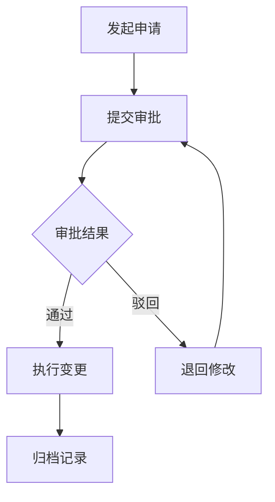

# 人事管理模块

## 模块概述

人事管理模块负责人事流程审批、入离职办理、人事异动等核心人事业务流程管理。

## 功能清单

### 1. 人事审批

- 入职审批
- 转正审批
- 调动审批
- 离职审批
- 请假审批
- 加班审批

### 2. 入离职办理

- 入职手续办理
- 离职手续办理
- 离职面谈记录
- 离职交接管理

### 3. 人事异动

- 岗位调整
- 部门调动
- 职级变更
- 薪资调整

## 技术实现

### 主要组件

```
views/PersonnelManagement/
├── ApprovalList.vue          # 审批列表
├── ApprovalDetail.vue        # 审批详情
├── EntryList.vue             # 入职列表
├── ResignList.vue            # 离职列表
├── TransferList.vue          # 异动列表
└── modules/
    ├── ApprovalModal.vue     # 审批弹窗
    ├── EntryModal.vue        # 入职弹窗
    └── TransferModal.vue     # 异动弹窗
```

### API 接口

```javascript
// 审批管理
export const getApprovalList = params => getAction('/hrm/approval/list', params)
export const submitApproval = params => postAction('/hrm/approval/submit', params)
export const approveApproval = params => postAction('/hrm/approval/approve', params)
export const rejectApproval = params => postAction('/hrm/approval/reject', params)

// 入离职管理
export const getEntryList = params => getAction('/hrm/entry/list', params)
export const getResignList = params => getAction('/hrm/resign/list', params)
```

## 业务流程



## 审批流程配置

### 审批节点

| 节点 | 审批人 | 说明 |
|------|--------|------|
| 部门审批 | 部门负责人 | 一级审批 |
| 人事审批 | 人事专员 | 二级审批 |
| 总经理审批 | 总经理 | 三级审批（可选） |

### 审批时限

| 审批类型 | 时限 |
|----------|------|
| 入职审批 | 3 个工作日 |
| 转正审批 | 5 个工作日 |
| 调动审批 | 5 个工作日 |
| 离职审批 | 7 个工作日 |

## 数据字典

### 审批状态

| 状态码 | 说明 |
|--------|------|
| 0 | 待提交 |
| 1 | 审批中 |
| 2 | 已通过 |
| 3 | 已驳回 |
| 4 | 已撤回 |

### 异动类型

| 类型码 | 说明 |
|--------|------|
| 1 | 入职 |
| 2 | 转正 |
| 3 | 调动 |
| 4 | 晋升 |
| 5 | 降级 |
| 6 | 离职 |

## 权限配置

| 权限标识 | 说明 |
|----------|------|
| approval:view | 查看审批 |
| approval:submit | 提交申请 |
| approval:approve | 审批通过 |
| approval:reject | 审批驳回 |
| entry:view | 查看入职 |
| resign:view | 查看离职 |

## 注意事项

1. 审批流程支持多级审批，最多支持 5 级
2. 审批超时自动提醒审批人
3. 离职审批通过后自动触发离职流程
4. 支持批量审批功能

## 相关文档

- [人员管理模块](../peoplemanagement/README.md)
- [考勤管理模块](../attendanceRule/README.md)
- [系统管理模块](../system/README.md)