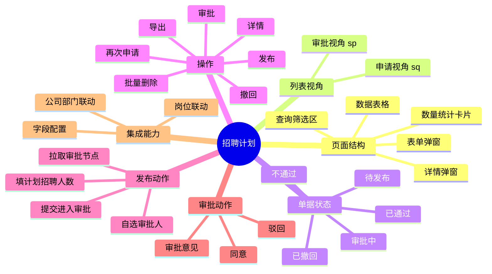
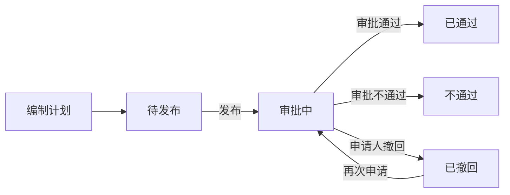

# 招聘计划

## 功能说明

管理招聘计划的编制、发布、审批、撤回与再次申请。计划先以「待发布」状态创建，勾选单条数据后执行**发布**：发布时填写计划招聘人数、按部门拉取审批节点并**自选各节点审批人**，提交后进入审批流程。页面支持「申请」与「审批」两种列表视角及数量统计。

## 思维导图



## 页面路径

`Recruitment/plan/index.vue`

| 文件 | 职责 |
|------|------|
| `index.vue` | 列表页（数量统计、查询、表格、行操作、发布入口） |
| `modules/RecruitmentPlanModal.vue` | 表单弹窗外壳（标题 / 提交按钮） |
| `modules/RecruitmentPlanForm.vue` | 计划表单（数据模型、校验、提交） |
| `modules/RecruitmentPlanDetailModal.vue` | 详情 / 发布 / 审批弹窗（核心操作都在此） |
| `modules/blocks/*` | 申请信息、岗位说明、计划信息、审批信息等分块 |
| `@comp/common/process/setIndex.vue` | 审批流程设置组件（拉节点 + 自选审批人） |
| `@comp/common/process/lookIndex.vue` | 审批流程查看组件（只读时间轴） |

## columnCode

`HrmZpjh`

## 列表视角（listType）

| 视角 | 值 | 默认状态 | 说明 |
|------|----|----------|------|
| 申请 | `sq`（默认） | 全部 | 我发起的招聘计划 |
| 审批 | `sp` | 审批中 | 待我审批 / 抄送我的计划 |

## 状态定义

```javascript
const STATUS_MAP = {
  待发布: { text: '待发布', color: 'orange' },
  审批中: { text: '审批中', color: 'gold' },
  已通过: { text: '已通过', color: 'green' },
  不通过: { text: '不通过', color: 'red' },
  已撤回: { text: '已撤回', color: '#ff4d4f' },
}
```

### 状态流转



> 发布是招聘计划的关键动作：在「待发布」数据上勾选一条，点击「发布」后填写人数与审批人，提交后状态变为「审批中」。

## 列定义

当前 `originalColumns` 实际启用的列：

| 列名 | dataIndex | 宽度 | 说明 |
|------|-----------|------|------|
| 状态 | zt | 100 | 彩色状态标签 |
| 公司 | deptPath | 380 | 取路径首段，超长 tooltip |
| 所属部门 | dept_dictText | 360 | 超长 tooltip |
| 岗位名称 | postId_dictText | 180 | |
| 职级名称 | levelId_dictText | 120 | |
| 员工类型 | employeeType | 100 | |
| 招聘人数 | zprs | 100 | |
| 计划招聘人数 | dzprs | 120 | 发布时填写 |

## 查询条件

- 公司（下拉，联动加载部门）
- 部门（级联选择，`deptId` / `deptPath`，依赖公司）
- 岗位名称（岗位选择器，联动部门）

## 操作按钮

- 发布（仅 `sq`，需勾选且仅勾选一条，否则提示）
- 导出（按列配置导出，`sq` 导出「招聘计划」，`sp` 导出「招聘计划审批」）
- 批量操作 → 删除（勾选后，仅 `sq`）

## 行操作

| 操作 | 显示条件 | 处理 |
|------|----------|------|
| 详情 | 始终 | 打开弹窗（`xq`） |
| 审批 | `sp` 且状态为「审批中」 | 打开弹窗（`sp`） |
| 再次申请 | `sq` 且状态为「已撤回」 | 当前复用详情弹窗入口（`bj`） |
| 撤回 | `sq` 且状态为「审批中」 | 二次确认后撤回 |

> 说明：列表行的「编辑」入口在源码中已注释；「再次申请」当前调用 `handleEdit` 以详情弹窗打开。表单弹窗 `RecruitmentPlanModal` 仍保留 `edit / again` 能力（对应 Form 的 `edit / reapply`），后续如需独立编辑表单可直接启用。

## 详情弹窗的三种模式（mode）

招聘计划的主要操作都集中在 `RecruitmentPlanDetailModal.vue`，通过 `mode` 区分：

| 模式 | 值 | 标题 | 审批流程区 | 底部按钮 |
|------|----|------|-----------|----------|
| 详情 | `xq` | 详情 | 只读时间轴 `lookIndex` | 关闭 |
| 发布 | `fb` | 发布招聘计划 | 可设置 `setIndex`，计划招聘人数可编辑 | 取消 / 发布 |
| 审批 | `sp` | 审批 | 只读时间轴，中栏显示审批信息 | 取消 / 提交 |

```javascript
open(record, mode) {
  this.record = Object.assign({}, record, { name: record.fqr })
  this.mode = mode === 'sp' ? 'sp' : mode === 'fb' ? 'fb' : 'xq'
  this.visible = true
}
```

## 核心方法

### 发布

```javascript
handlePublish() {
  if (this.selectedRowKeys.length !== 1) {
    return this.$message.warning('请勾选一条数据再发布')
  }
  this.$refs.detailModal.open(this.selectionRows[0], 'fb')
}
```

发布提交：校验计划招聘人数，组装节点后状态置为「审批中」，调发布接口：

```javascript
buildSubmitPayload() {
  return Object.assign({}, this.record, {
    zt: '审批中',
    customProcessConfigurationDTOList: this.$refs.approvalProcess.getCustomProcessList(),
  })
}

handlePublishSubmit() {
  if (this.record.dzprs == null || this.record.dzprs === '') {
    return this.$message.warning('请输入计划招聘人数')
  }
  httpAction(this.url.edit, this.buildSubmitPayload(), 'post')
  // 成功提示「发布成功」
}
```

### 审批

审批意见由审批信息分块提供，统一走 `sharedSubmit`：

```javascript
sharedSubmit(record, value) {
  const userInfo = Vue.ls.get('perInfo')
  httpAction(this.url.updateSpStatus, {
    id: record.id,
    currentSpId: userInfo.id,
    spStatus: value.result,    // 审批结果
    spOpinion: value.comment,  // 审批意见
  }, 'post')
}

handleApproveSubmit() {
  const value = this.$refs.approveBlock.getValue()
  this.sharedSubmit(this.record, value)
}
```

### 撤回

```javascript
handleCancelApply(record) {
  this.$refs.detailModal.sharedSubmit(record, { result: '3', comment: '申请人撤回' })
}
```

### 数量统计

```javascript
getStatusTotal() {
  httpAction(this.url.getTotal, '', 'get').then(res => {
    // 按 statusText -> statustotal 回填各状态卡片 count
  })
}
```

## 审批人选择与回显

发布模式（`fb`）下，审批流程区使用 [setIndex.vue](file:///d:/projects/ztqr/qr-hrm/ant-design-vue-jeecg/src/components/common/process/setIndex.vue)：

```vue
<set-flow
  v-if="mode === 'fb'"
  :key="record.id || record.sourceApplyId || 'new'"
  ref="approvalProcess"
  sqmkCode="招聘计划"
  :dept="record.dept"
  :no="record.fqrgh"
  :saved-nodes="record.customProcessConfigurationDTOList"
/>
<log-flow v-else :applyId="record.id" :LCdata="record" />
```

- **节点来源**：始终调 `getLcjdList` 接口按部门拉取最新模板节点，并按 `px` 排序
- **自选审批人**：`isselfSelect=1` / `sprScope=4` 的节点，或空级审批节点（`kjSprType`，如直属主管 / 经理 / 总监）可添加、删除审批人
- **提交（正向）**：`getCustomProcessList()` 将每节点选中人员的 `id / name` 用逗号拼接，写入节点外层 `chooseObjects / chooseObjectsName`
- **回显（逆向）**：节点仍取接口最新数据，仅按节点顺序用 `savedNodes[idx]` 外层的 `chooseObjects / chooseObjectsName` 拆分还原选中人员；该位置无保存数据时使用模板默认人员
- **key 的作用**：以单据 id 作为组件身份，切换数据时强制重建，避免同部门下 watch 不触发导致显示上一条数据的审批人

> 回显前提：进入发布 / 再次申请时，`record` 中需带 `customProcessConfigurationDTOList`（结构与提交时一致）。

## 字段配置集成

```javascript
mixins: [JeecgListMixin, mixinDevice, columnConfigMixin, recruitmentOrgFilterMixin]
// columnCode: 'HrmZpjh'
// columns 尾部追加固定「操作」列后交给 applyColumnConfig 处理
```

字段配置侧边栏组件已保留，入口按钮默认注释。

## API 接口

| 用途 | 方法 / 地址 |
|------|-------------|
| 列表 | `GET /zpManage/hrmZpjh/list` |
| 新增 | `POST /zpManage/hrmZpjh/add` |
| 编辑 | `PUT /zpManage/hrmZpjh/edit` |
| 发布 | `POST /zpManage/hrmZpjh/publish`（详情弹窗 `url.edit`） |
| 更新审批状态 | `POST /zpManage/hrmZpjh/updateSpStatus` |
| 删除 | `DELETE /zpManage/hrmZpjh/delete` |
| 批量删除 | `DELETE /zpManage/hrmZpjh/deleteBatch` |
| 导出 | `GET /zpManage/hrmZpjh/exportXls` |
| 导入 | `POST /zpManage/hrmZpjh/importExcel` |
| 数量统计 | `GET /zpManage/hrmZpjh/getTotal` |
| 审批节点 | `GET /process/customProcessConfiguration/getLcjdList` |
| 组织树根 | `/zpManage/hrmZpjh/loadTreeRoot` |
| 岗位联动 | `/zpManage/hrmZpjh/getChildSequences` |

## 相关文档

- [用人申请](../yongren/用人申请.md)
- [招聘管理](../招聘管理.md)
