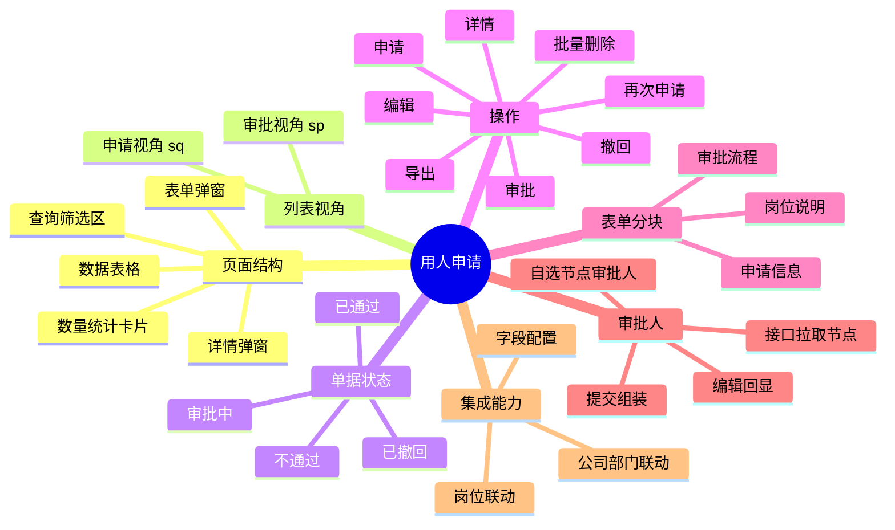
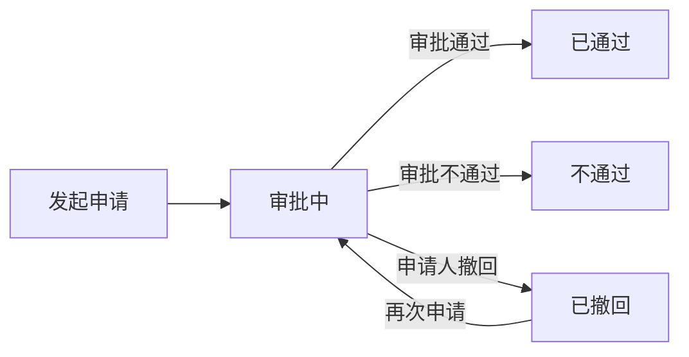

# 用人申请

## 功能说明

管理用人申请的发起、审批、撤回与再次申请，跟踪招聘进度和数量统计。申请人通过表单填写岗位、任职要求、薪资等信息，并在审批流程中**自选各节点审批人**；单据可在「申请」与「审批」两种列表视角下展示。

## 思维导图



## 页面路径

`Recruitment/yongren/index.vue`

| 文件 | 职责 |
|------|------|
| `index.vue` | 列表页（数量统计、查询、表格、行操作） |
| `modules/RecruitmentApplyModal.vue` | 表单弹窗外壳（标题 / 提交按钮） |
| `modules/RecruitmentApplyForm.vue` | 申请表单（数据模型、校验、提交） |
| `modules/RecruitmentApplyDetailModal.vue` | 详情 / 审批弹窗 |
| `modules/blocks/*` | 申请信息、岗位说明、审批信息等分块组件 |
| `@comp/common/process/setIndex.vue` | 审批流程设置组件（拉节点 + 自选审批人） |
| `@comp/common/process/lookIndex.vue` | 审批流程查看组件（只读时间轴） |

## columnCode

`HrmYrsq`

## 列表视角（listType）

页面通过 `listType` 区分两种视角，影响状态卡片、默认筛选与行操作：

| 视角 | 值 | 默认状态 | 说明 |
|------|----|----------|------|
| 申请 | `sq`（默认） | 全部 | 我发起的用人申请 |
| 审批 | `sp` | 审批中 | 待我审批 / 抄送我的单据 |

## 状态定义

```javascript
const STATUS_MAP = {
  审批中: { text: '审批中', color: 'orange' },
  已通过: { text: '已通过', color: 'green' },
  已撤回: { text: '已撤回', color: '#ff4d4f' },
  不通过: { text: '不通过', color: 'red' },
}
```

> 注：`申请列表主要流转于 `审批中 / 已通过 / 不通过 / 已撤回`。

### 状态流转



## 列定义

当前 `originalColumns` 实际启用的列：

| 列名 | dataIndex | 宽度 | 说明 |
|------|-----------|------|------|
| 状态 | zt | 100 | 彩色状态标签 |
| 公司 | deptPath | 380 | 取路径首段，超长 tooltip |
| 所属部门 | dept_dictText | 360 | 超长 tooltip |
| 发起人 | fqr | 120 | 空值显示「-」 |
| 岗位名称 | postId_dictText | 180 | |
| 职级名称 | levelId_dictText | 120 | |
| 员工类型 | employeeType | 100 | |
| 招聘人数 | zprs | 100 | |

> 其余列（剩余招聘人数、入职人数、希望到岗日期、薪资、简历 / 面试 / offer 统计、审批人等）在源码中已预留但被注释，可按需开启。

## 查询条件

- 发起时间（日期范围 `fqsj_begin` / `fqsj_end`）
- 发起人（文本，`fqr`）
- 公司（下拉，联动加载部门）
- 部门（级联选择，`deptId` / `deptPath`，依赖公司）
- 岗位名称（岗位选择器，联动部门）

## 操作按钮

- 申请（仅 `sq` 视角）
- 导出（按列配置导出，`sq` 导出「用人申请」，`sp` 导出「用人审批」）
- 批量操作 → 删除（勾选后，仅 `sq`）

## 行操作

| 操作 | 显示条件 | 处理 |
|------|----------|------|
| 详情 | 始终 | 打开详情弹窗（`xq`） |
| 编辑 | `sq` 且状态非「已通过 / 不通过」 | 打开表单编辑 |
| 审批 | `sp` 且状态为「审批中」 | 打开详情弹窗（`sp`） |
| 再次申请 | `sq` 且状态为「已撤回」 | 表单重新发起 |
| 撤回 | `sq` 且状态为「审批中」 | 二次确认后撤回 |

## 核心方法

### 发起 / 编辑 / 再次申请

弹窗外壳方法对应到表单的三种数据初始化：

```javascript
// Modal
add()    // -> Form.add()       新增，createDefaultModel()
edit()   // -> Form.edit()      编辑，保留 id
again()  // -> Form.reapply()   再次申请，清空 id、记录 sourceApplyId
```

```javascript
// Form：编辑 / 再次申请共用，asReapply 区分
setModelFromRecord(record, asReapply) {
  this.model = Object.assign(createDefaultModel(), {
    ...record,
    id: asReapply ? '' : record.id || '',
    sourceApplyId: asReapply ? record.id || '' : record.sourceApplyId || '',
    xwdgrq: getDateText(record.xwdgrq),
    // ...
  })
}
```

### 提交

```javascript
submitForm() {
  this.$refs.form.validate(valid => {
    if (!valid) return this.$message.warning('请完善必填信息')
    // 最高薪资 ≥ 最低薪资、年龄上限 ≥ 年龄下限
    const payload = this.buildSubmitPayload()
    const httpurl = payload.id ? this.url.edit : this.url.add
    const method = payload.id ? 'put' : 'post'
    httpAction(httpurl, payload, method)
  })
}
```

提交载荷中通过审批流程组件组装节点：

```javascript
buildSubmitPayload() {
  return {
    ...this.model,
    customProcessConfigurationDTOList: this.$refs.approvalProcess.getCustomProcessList(),
  }
}
```

### 撤回

```javascript
handleCancelApply(record) {
  // 复用详情弹窗的提交通道，result='3' 表示申请人撤回
  this.$refs.detailModal.sharedSubmit(record, { result: '3', comment: '申请人撤回' })
}
```

### 数量统计

```javascript
getStatusTotal() {
  httpAction(this.url.getTotal, '', 'get').then(res => {
    // 按 statusText -> statustotal 回填到各状态卡片 count
  })
}
```

## 审批人选择与回显

审批流程区使用 [setIndex.vue](file:///d:/projects/ztqr/qr-hrm/ant-design-vue-jeecg/src/components/common/process/setIndex.vue)：

```vue
<log-flow
  :key="model.id || model.sourceApplyId || 'new'"
  ref="approvalProcess"
  sqmkCode="用人申请"
  :dept="model.dept"
  :no="model.fqrgh"
  :saved-nodes="model.customProcessConfigurationDTOList"
/>
```

- **节点来源**：始终调 `getLcjdList` 接口按部门拉取最新模板节点，并按 `px` 排序
- **自选审批人**：`isselfSelect=1` / `sprScope=4` 的节点，或空级审批节点（`kjSprType`，如直属主管 / 经理 / 总监）可添加、删除审批人
- **提交（正向）**：`getCustomProcessList()` 将每节点选中人员的 `id / name` 用逗号拼接，写入节点外层 `chooseObjects / chooseObjectsName`
- **回显（逆向）**：节点仍取接口最新数据，仅按节点顺序用 `savedNodes[idx]` 外层的 `chooseObjects / chooseObjectsName` 拆分还原选中人员；该位置无保存数据时使用模板默认人员
- **key 的作用**：以单据 id 作为组件身份，切换单据或再次申请时强制重建组件，避免同部门下 watch 不触发导致显示上一张单据的审批人

> 回显前提：编辑 / 再次申请进入时，`record` 中需带 `customProcessConfigurationDTOList`（结构与提交时一致）。

## 字段配置集成

```javascript
mixins: [JeecgListMixin, mixinDevice, columnConfigMixin, recruitmentOrgFilterMixin]
// columnCode: 'HrmYrsq'
// columns 尾部追加固定「操作」列后交给 applyColumnConfig 处理
```

字段配置按钮当前在源码中保留组件与侧边栏，入口按钮默认注释。

## API 接口

| 用途 | 方法 / 地址 |
|------|-------------|
| 列表 | `GET /zpManage/hrmYrsq/list` |
| 新增 | `POST /zpManage/hrmYrsq/add` |
| 编辑 | `PUT /zpManage/hrmYrsq/edit` |
| 删除 | `DELETE /zpManage/hrmYrsq/delete` |
| 批量删除 | `DELETE /zpManage/hrmYrsq/deleteBatch` |
| 导出 | `GET /zpManage/hrmYrsq/exportXls` |
| 导入 | `POST /zpManage/hrmYrsq/importExcel` |
| 详情 | `GET /zpManage/hrmYrsq/queryById` |
| 数量统计 | `GET /zpManage/hrmYrsq/getTotal` |
| 审批节点 | `GET /process/customProcessConfiguration/getLcjdList` |
| 组织树根 | `/zpManage/hrmYrsq/loadTreeRoot` |
| 岗位联动 | `/zpManage/hrmYrsq/getChildSequences` |

## 相关文档

- [招聘计划](../plan/招聘计划.md)
- [招聘管理](../招聘管理.md)
