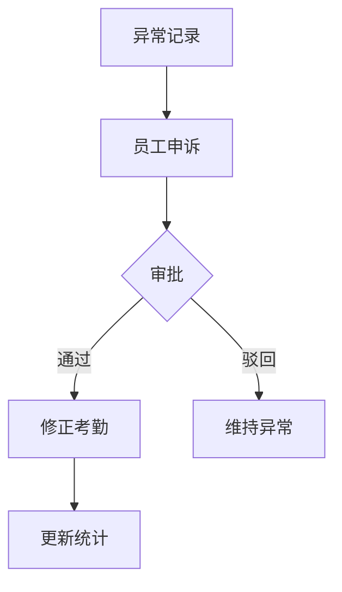

# 异常考勤模块

> 异常考勤记录与处理

## 概述

异常考勤模块用于记录和处理员工打卡异常情况，如迟到、早退、缺卡等。

## 子模块

| 目录 | 功能 |
|------|------|
| `abnormal-attendance-record/` | 异常记录管理 |

## 异常类型

- 迟到
- 早退
- 缺卡
- 旷工

## 处理流程

## 相关模块

- [员工考勤](../EmployeeAttendance/README.md)
- [审批中心](../approval/README.md)
