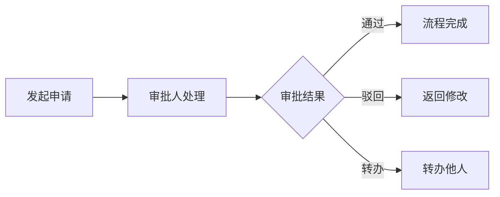

# 审批中心模块

> 统一审批流程管理

## 概述

审批中心模块提供统一的审批流程管理，支持多种业务审批类型。

## 子模块

| 目录 | 功能 |
|------|------|
| `apply/` | 申请入口 |
| `pages/` | 审批页面 |

## 支持的审批类型

- 请假审批
- 加班审批
- 外出审批
- 补卡审批
- 访客审批
- 放行条审批

## 审批流程

## 核心功能

- 我的申请
- 待我审批
- 已审批记录
- 审批统计分析

## 相关模块

- [请假管理](../leave-management/README.md)
- [访客管理](../visitor/README.md)
- [考勤规则](../attendanceRule/README.md)
