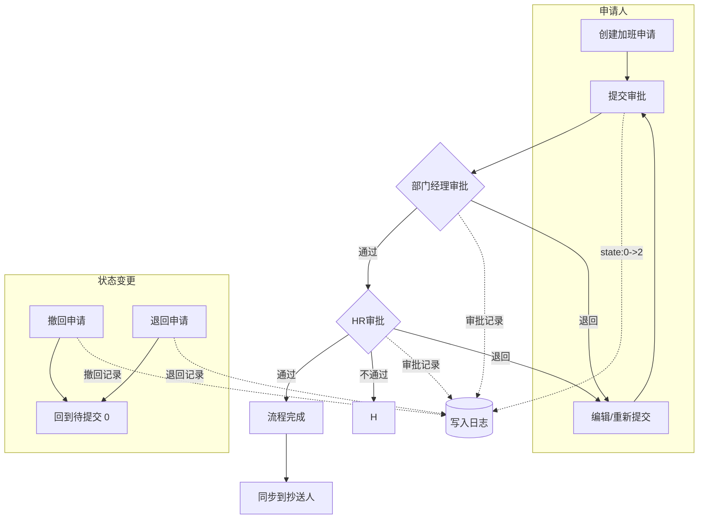
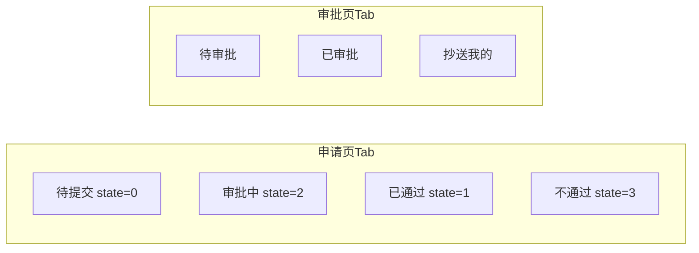

# 加班申请模块

## 模块概述

加班申请模块是 HRM 系统中考勤管理的重要组成部分，支持员工在线提交加班申请、部门/HR 逐级审批、记录审批全流程日志。

## 文件结构

```
ot/
├── README.md                        # 本文档（含流程思维导图）
├── HrOvertimeApplyList.vue          # 申请列表页 + 审批列表页（主页面）
├── modules/
│   ├── HrOvertimeApplyModal.vue     # 新增/编辑/审批/详情弹窗
│   ├── HrOvertimeApplyForm.vue      # 加班申请表单
│   ├── HrOvertimeApplyLog.vue       # 审批日志/时间轴组件
│   └── HrRejectModal.vue            # 退回弹窗组件
└── dy/
    └── HrOvertimePrint.vue          # 加班申请打印模板（预留）
```

## 状态定义

### state（数据主状态）
| 值 | 含义 | 说明 |
|----|------|------|
| 0 | 待提交 | 草稿/已撤回/已退回 |
| 1 | 已通过 | 全部审批通过 |
| 2 | 审批中 | 正在审批流程中 |
| 3 | 不通过 | 审批被否决 |

### approvalStatus（审批节点位置）
| 值 | 含义 |
|----|------|
| 0 | 申请人（初始） |
| 1 | 部门经理审批 |
| 2 | HR 审批 |
| 3 | 抄送人（流程结束） |

## 页面 Tab 结构

### 申请页（申请人视角）
| Tab | 筛选条件 |
|-----|----------|
| 待提交 | state = 0 |
| 审批中 | state = 2 |
| 已通过 | state = 1 |
| 不通过 | state = 3 |

### 审批页（审批人视角）
| Tab | 筛选条件 |
|-----|----------|
| 待审批 | state = 2，当前审批节点审批人包含登录人 |
| 已审批 | 当前登录人已审批过的所有记录 |
| 抄送我的 | 抄送人包含当前登录人 |

## 业务流程





## 数据表设计

### 主表: hr_jb_application（加班申请表）
| 字段 | 类型 | 说明 |
|------|------|------|
| id | String | 主键ID |
| employeeId | String | 员工表ID（关联 hr_employee_information） |
| companyId | String | 公司 |
| dept | String | 部门 |
| no | String | 工号 |
| name | String | 姓名 |
| overtimeType | String | 加班类型（根据节假日日历自动判定） |
| startTime | String | 加班开始时间 |
| endTime | String | 加班结束时间 |
| duration | Number | 申请时长（小时，自动计算，最小0.5） |
| reason | String | 加班原因 |
| attachment | String | 附件 |
| calculateType | String | 加班核算方式（从考勤规则获取） |
| state | Number | 数据状态: 0待提交 1已通过 2审批中 3不通过 |
| approvalStatus | Number | 当前审批节点: 0申请人 1部门经理 2HR 3抄送人 |
| approver | String | 当前审批人 |
| ccPerson | String | 抄送人 |
| createTime | String | 创建时间 |
| createBy | String | 创建人 |

### 子表: hr_jb_application_approval_record（审批流程记录表）
| 字段 | 类型 | 说明 |
|------|------|------|
| id | String | 主键ID |
| applyId | String | 加班申请表ID |
| approvalStatus | Number | 审批节点 |
| approver | String | 审批人 |
| result | Number | 审批结果: 0不通过 1通过 2退回 3撤回 |
| opinion | String | 审批意见 |
| approvalTime | String | 审批时间 |

## 接口清单

> 📌 以下为接口路径占位，接入真实后端时替换对应的 `// TODO: 接口路径` 注释

| 功能 | 方法 | 接口路径 |
|------|------|---------|
| 分页列表查询 | GET | /hr/attendance/jbApplication/list |
| 审批列表查询 | GET | /hr/attendance/jbApplication/listApproval |
| 已审批列表查询 | GET | /hr/attendance/jbApplication/listApproved |
| 抄送我的列表查询 | GET | /hr/attendance/jbApplication/listCCed |
| 通过ID查询 | GET | /hr/attendance/jbApplication/queryById |
| 新增 | POST | /hr/attendance/jbApplication/add |
| 编辑 | PUT | /hr/attendance/jbApplication/edit |
| 删除 | DELETE | /hr/attendance/jbApplication/delete |
| 提交审批 | POST | /hr/attendance/jbApplication/submit |
| 审批通过/不通过 | POST | /hr/attendance/jbApplication/submitApproval |
| 撤回 | POST | /hr/attendance/jbApplication/revoke |
| 退回 | POST | /hr/attendance/jbApplication/goBack |
| 审批日志列表 | GET | /hr/attendance/jbApplicationLog/list |
