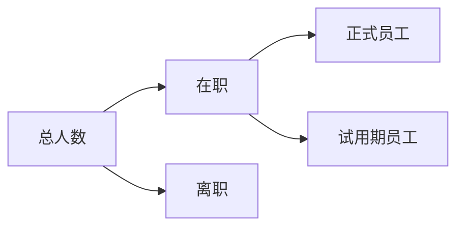

# 仪表盘模块

## 模块概述

仪表盘模块提供人力资源数据可视化和关键指标展示，帮助管理者快速了解企业人力资源状况。

## 功能清单

### 1. 人员统计

- 员工总数统计
- 部门人员分布
- 性别比例分析
- 年龄结构分析
- 学历分布统计

### 2. 人事动态

- 本月入职人数
- 本月离职人数
- 转正人数统计
- 异动情况分析

### 3. 考勤分析

- 出勤率统计
- 加班时长统计
- 请假情况分析
- 考勤异常统计

### 4. 合同管理

- 合同到期提醒
- 合同签订统计
- 合同续签预警

## 技术实现

### 主要组件

```
views/dashboard/
├── Index.vue                  # 仪表盘首页
├── modules/
│   ├── EmployeeChart.vue      # 人员统计图表
│   ├── PersonnelChart.vue     # 人事动态图表
│   ├── AttendanceChart.vue    # 考勤分析图表
│   └── ContractChart.vue      # 合同管理图表
└── components/
    ├── StatCard.vue           # 统计卡片
    └── TrendChart.vue         # 趋势图表
```

### API 接口

```javascript
// 统计数据
export const getEmployeeStats = params => getAction('/hrm/stats/employee', params)
export const getPersonnelStats = params => getAction('/hrm/stats/personnel', params)
export const getAttendanceStats = params => getAction('/hrm/stats/attendance', params)
export const getContractStats = params => getAction('/hrm/stats/contract', params)

// 图表数据
export const getDepartmentChart = params => getAction('/hrm/chart/department', params)
export const getAgeChart = params => getAction('/hrm/chart/age', params)
export const getEducationChart = params => getAction('/hrm/chart/education', params)
```

## 图表类型

### 人员统计



### 部门分布

- 图表类型：饼图
- 数据维度：部门
- 展示内容：各部门人数占比

### 年龄结构

- 图表类型：柱状图
- 数据维度：年龄段
- 展示内容：各年龄段人数

### 学历分布

- 图表类型：饼图
- 数据维度：学历
- 展示内容：各学历人数占比

## 数据刷新

### 刷新策略

| 数据类型 | 刷新频率 | 说明 |
|----------|----------|------|
| 实时数据 | 5 分钟 | 员工总数、在职人数 |
| 日数据 | 每天 0 点 | 考勤统计、加班统计 |
| 月数据 | 每月 1 号 | 人事动态、合同统计 |

### 数据缓存

- 缓存时间：30 分钟
- 缓存策略：首次加载缓存，定时刷新
- 缓存失效：手动刷新、数据变更

## 权限配置

| 权限标识 | 说明 |
|----------|------|
| dashboard:view | 查看仪表盘 |
| dashboard:export | 导出数据 |
| dashboard:refresh | 手动刷新 |

## 导出功能

### 导出格式

- Excel 格式（.xlsx）
- PDF 格式（.pdf）
- 图片格式（.png）

### 导出内容

- 统计数据表格
- 图表截图
- 分析报告

## 注意事项

1. 仪表盘数据为统计汇总数据，非实时数据
2. 图表支持交互，可点击查看详情
3. 数据导出需有相应权限
4. 建议使用 Chrome 浏览器获得最佳体验

## 相关文档

- [人员管理模块](../peoplemanagement/README.md)
- [人事管理模块](../PersonnelManagement/README.md)
- [考勤管理模块](../attendanceRule/README.md)
- [系统管理模块](../system/README.md)