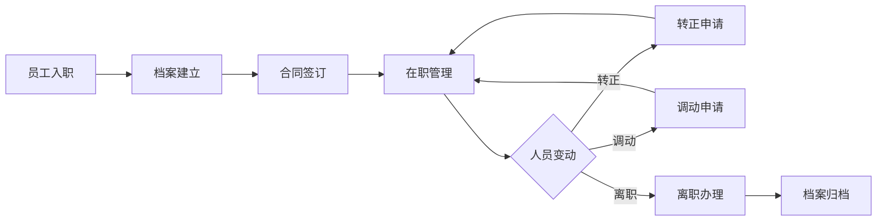

# 人员管理模块

## 模块概述

人员管理模块是 QR-HRM 系统的核心模块之一，负责员工全生命周期管理，包括员工档案、合同管理、人员变动等功能。

## 功能清单

### 1. 员工档案管理

- 员工基本信息维护
- 员工照片上传
- 紧急联系人信息
- 教育经历记录
- 工作经历记录
- 家庭成员信息

### 2. 合同管理

- 合同签订
- 合同续签
- 合同变更
- 合同终止
- 合同到期提醒

### 3. 人员变动

- 入职办理
- 转正申请
- 调动管理
- 离职办理
- 复职管理

## 技术实现

### 主要组件

```
views/peoplemanagement/
├── EmployeeList.vue          # 员工列表
├── EmployeeDetail.vue        # 员工详情
├── ContractList.vue          # 合同列表
├── ContractForm.vue          # 合同表单
├── TransferList.vue          # 变动列表
└── modules/
    ├── EmployeeModal.vue     # 员工信息弹窗
    ├── ContractModal.vue     # 合同信息弹窗
    └── TransferModal.vue     # 变动信息弹窗
```

### API 接口

```javascript
// 员工管理
export const getEmployeeList = params => getAction('/hrm/employee/list', params)
export const getEmployeeById = id => getAction('/hrm/employee/' + id)
export const addEmployee = params => postAction('/hrm/employee/add', params)
export const editEmployee = params => putAction('/hrm/employee/edit', params)
export const deleteEmployee = id => deleteAction('/hrm/employee/' + id)

// 合同管理
export const getContractList = params => getAction('/hrm/contract/list', params)
export const addContract = params => postAction('/hrm/contract/add', params)
export const editContract = params => putAction('/hrm/contract/edit', params)
```

## 业务流程



## 数据字典

### 员工状态

| 状态码 | 说明 |
|--------|------|
| 0 | 待入职 |
| 1 | 在职 |
| 2 | 离职 |
| 3 | 停薪留职 |

### 合同状态

| 状态码 | 说明 |
|--------|------|
| 0 | 待生效 |
| 1 | 生效中 |
| 2 | 已到期 |
| 3 | 已终止 |

## 权限配置

| 权限标识 | 说明 |
|----------|------|
| employee:view | 查看员工信息 |
| employee:add | 新增员工 |
| employee:edit | 编辑员工 |
| employee:delete | 删除员工 |
| contract:view | 查看合同 |
| contract:add | 新增合同 |
| contract:edit | 编辑合同 |

## 注意事项

1. 员工编号自动生成，格式：EMP + 年月日 + 序号
2. 合同到期前 30 天系统自动提醒
3. 离职员工档案保留 2 年后归档
4. 员工照片支持 JPG、PNG 格式，大小不超过 2MB

## 相关文档

- [人事管理模块](../PersonnelManagement/README.md)
- [考勤管理模块](../attendanceRule/README.md)
- [系统管理模块](../system/README.md)