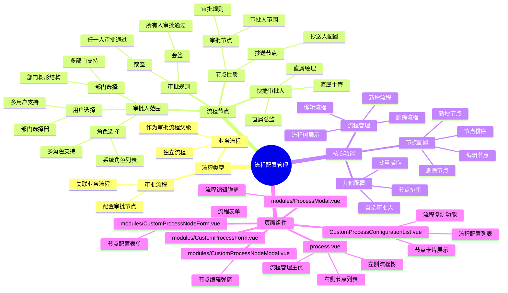
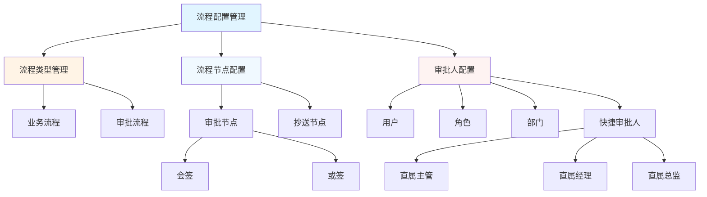
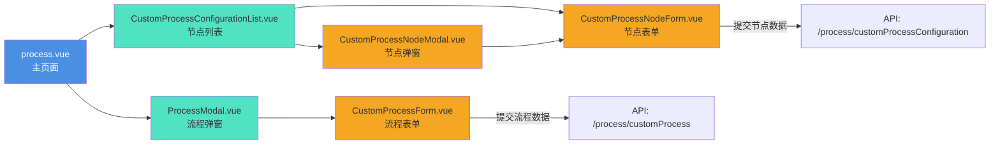
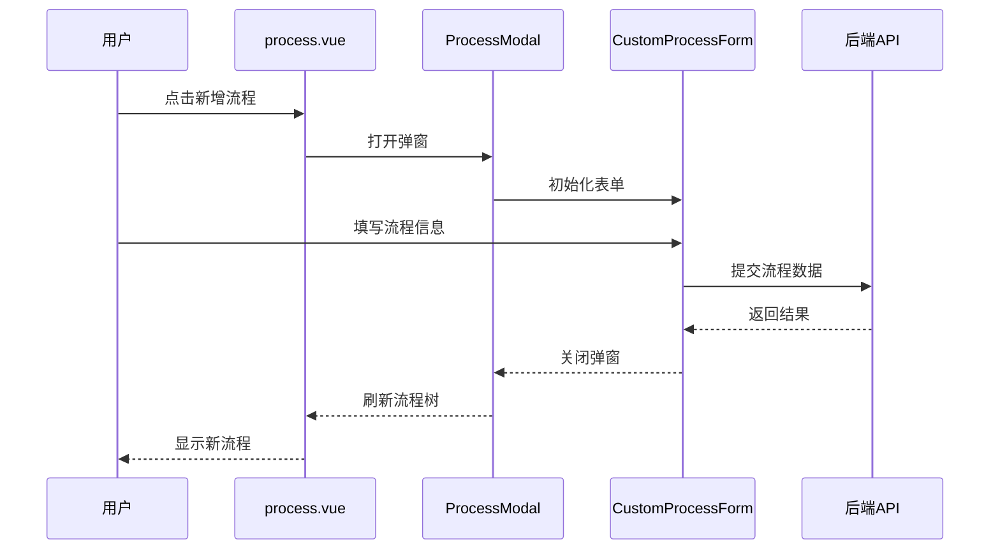

# 流程配置管理模块

## 模块概述

本模块提供自定义流程配置功能，支持业务流程和审批流程的创建与管理，包含流程节点配置、审批人范围设置等功能。

## 模块思维导图



## 功能架构图



## 组件关系图



## 数据流程图



## 目录结构

```
process/
├── process.vue                              # 流程管理主页面（树形结构 + 节点列表）
├── CustomProcessConfigurationList.vue       # 流程配置列表页面
├── modules/
│   ├── ProcessModal.vue                     # 流程编辑弹窗
│   ├── CustomProcessForm.vue                # 流程表单组件
│   ├── CustomProcessNodeModal.vue           # 流程节点编辑弹窗
│   └── CustomProcessNodeForm.vue            # 流程节点表单组件
└── README.md                                # 本文档
```

## 核心功能

### 1. 流程类型管理

- **业务流程**：独立的业务类型流程
- **审批流程**：关联业务流程的审批节点流程

### 2. 流程节点配置

#### 节点性质
- **审批节点**：配置审批人、审批规则
- **抄送节点**：配置抄送人信息

#### 审批人范围
支持三种审批人范围选择：
- **用户**：通过部门选择器选择具体用户
- **角色**：从系统角色列表中选择
- **部门**：选择整个部门作为审批范围

#### 快捷审批人
提供快捷审批人配置：
- 直属主管
- 直属经理
- 直属总监

#### 多人审批规则
- **会签**：所有审批人都需要审批通过
- **或签**：任一审批人审批通过即可

### 3. 其他配置

- **是否自选审批人**：允许申请人自行选择审批人
- **是否抄送人**：抄送节点配置
- **排序**：节点执行顺序

## API 接口

### 流程管理接口

| 接口路径 | 方法 | 说明 |
|---------|------|------|
| `/process/customProcess/add` | POST | 新增流程 |
| `/process/customProcess/edit` | PUT | 编辑流程 |
| `/process/customProcess/queryById` | GET | 根据ID查询流程 |
| `/process/customProcess/list` | GET | 查询流程列表 |
| `/process/customProcess/delete` | DELETE | 删除流程 |

### 流程节点配置接口

| 接口路径 | 方法 | 说明 |
|---------|------|------|
| `/process/customProcessConfiguration/add` | POST | 新增流程节点 |
| `/process/customProcessConfiguration/edit` | PUT | 编辑流程节点 |
| `/process/customProcessConfiguration/queryById` | GET | 根据ID查询节点 |
| `/process/customProcessConfiguration/list` | GET | 查询节点列表 |
| `/process/customProcessConfiguration/delete` | DELETE | 删除流程节点 |

## 组件说明

### process.vue
流程管理主页面，采用左右布局：
- 左侧：流程树形结构（业务流程 + 审批流程）
- 右侧：选中流程的节点配置列表

### CustomProcessConfigurationList.vue
流程配置列表页面，提供：
- 流程列表展示
- 新增/编辑/删除流程
- 配置流程节点

### ProcessModal.vue
流程编辑弹窗容器，负责：
- 弹窗显示控制
- 加载流程详情
- 提交流程表单

### CustomProcessForm.vue
流程表单组件，包含：
- 流程名称输入
- 流程类型选择（业务/审批流程）
- 所属业务选择（审批流程时显示）

### CustomProcessNodeModal.vue
流程节点编辑弹窗容器，负责：
- 弹窗显示控制
- 提交节点配置

### CustomProcessNodeForm.vue
流程节点表单组件，包含：
- 基础信息配置（节点名称、性质、排序）
- 审批人范围配置（用户/角色/部门）
- 审批规则配置（会签/或签）
- 快捷审批人配置（主管/经理/总监）

## 数据模型

### 流程数据结构

```javascript
{
  id: '',                    // 流程ID
  lcmc: '',                  // 流程名称
  fzlc: '业务',              // 流程类型：'业务' | '审批流程'
  pid: ''                    // 所属业务ID（审批流程时有效）
}
```

### 流程节点数据结构

```javascript
{
  id: '',                      // 节点ID
  customProcessId: '',         // 所属流程ID
  nodeName: '',                // 节点名称
  nodeProperties: 1,           // 节点性质：1-审批，2-抄送
  promoter: 0,                 // 是否抄送人：0-否，1-是
  chooseUsers: 0,              // 是否选择用户：0-否，1-是
  chooseRoles: 0,              // 是否选择角色：0-否，1-是
  chooseDepartments: 0,        // 是否选择部门：0-否，1-是
  px: 0,                       // 排序
  isselfSelect: 0,             // 是否自选审批人：0-否，1-是
  ismultiPerson: 1,            // 是否多人审批：0-否，1-是
  approvalRule: 1,             // 审批规则：1-会签，2-或签
  zszg: 0,                     // 直属主管：0-否，1-是
  zsjl: 0,                     // 直属经理：0-否，1-是
  zszj: 0,                     // 直属总监：0-否，1-是
  users: [],                   // 用户列表
  roles: [],                   // 角色列表
  departments: []              // 部门列表
}
```

## 使用示例

### 新增业务流程

1. 点击"新增流程"按钮
2. 选择流程类型为"业务"
3. 输入流程名称
4. 提交保存

### 新增审批流程

1. 点击"新增流程"按钮
2. 选择流程类型为"审批流程"
3. 输入流程名称
4. 选择所属业务
5. 提交保存

### 配置审批节点

1. 在流程列表中选择目标流程
2. 点击"新增节点"按钮
3. 配置节点基础信息（名称、性质、排序）
4. 选择审批人范围（用户/角色/部门）
5. 配置审批规则（会签/或签）
6. 配置快捷审批人（可选）
7. 提交保存

## 注意事项

1. 审批流程必须关联业务流程
2. 审批节点至少需要配置一个审批人范围或快捷审批人
3. 抄送节点不需要配置审批规则
4. 节点排序决定审批流程执行顺序
5. 删除流程时会级联删除该流程下的所有节点配置

## 依赖组件

- `j-modal` - 弹窗组件
- `j-form-container` - 表单容器
- `j-select-user-by-dep` - 用户选择器
- `j-select-depart` - 部门选择器
- `j-multi-select-tag` - 多选标签组件

## 相关文档

- [Ant Design Vue 文档](https://www.antdv.com/)
- [JeecgBoot 开发文档](http://doc.jeecg.com/)