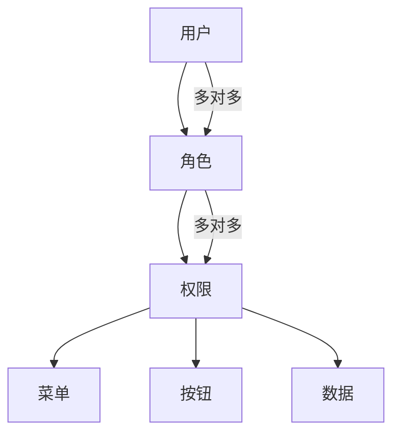

# 系统管理模块

## 模块概述

系统管理模块负责用户管理、角色权限、菜单配置、系统设置等基础功能，是整个系统的管理中枢。

## 功能清单

### 1. 用户管理

- 用户账号管理
- 用户角色分配
- 用户部门归属
- 用户状态管理
- 密码重置

### 2. 角色权限

- 角色管理
- 权限配置
- 角色授权
- 权限继承

### 3. 菜单管理

- 菜单配置
- 菜单权限
- 菜单排序
- 菜单图标

### 4. 系统设置

- 系统参数配置
- 数据字典管理
- 系统日志
- 定时任务

## 技术实现

### 主要组件

```
views/system/
├── user/                      # 用户管理
│   ├── UserList.vue           # 用户列表
│   └── modules/
│       ├── UserModal.vue      # 用户弹窗
│       └── UserPassword.vue   # 密码重置
├── role/                      # 角色管理
│   ├── RoleList.vue           # 角色列表
│   └── modules/
│       ├── RoleModal.vue      # 角色弹窗
│       └── RolePermission.vue # 权限配置
├── menu/                      # 菜单管理
│   └── MenuList.vue           # 菜单列表
└── config/                    # 系统配置
    ├── DictList.vue           # 数据字典
    └── LogList.vue            # 系统日志
```

### API 接口

```javascript
// 用户管理
export const getUserList = params => getAction('/sys/user/list', params)
export const addUser = params => postAction('/sys/user/add', params)
export const editUser = params => putAction('/sys/user/edit', params)
export const deleteUser = id => deleteAction('/sys/user/' + id)
export const resetPassword = id => postAction('/sys/user/resetPwd/' + id)

// 角色管理
export const getRoleList = params => getAction('/sys/role/list', params)
export const addRole = params => postAction('/sys/role/add', params)
export const editRole = params => putAction('/sys/role/edit', params)
export const saveRolePermission = params => postAction('/sys/role/permission', params)
```

## 权限模型



## 数据字典

### 用户状态

| 状态码 | 说明 |
|--------|------|
| 0 | 正常 |
| 1 | 冻结 |
| 2 | 删除 |

### 角色类型

| 类型码 | 说明 |
|--------|------|
| 1 | 系统角色 |
| 2 | 业务角色 |
| 3 | 自定义角色 |

### 菜单类型

| 类型码 | 说明 |
|--------|------|
| 0 | 目录 |
| 1 | 菜单 |
| 2 | 按钮 |

## 权限配置

### 系统管理员权限

- 用户管理：全部权限
- 角色管理：全部权限
- 菜单管理：全部权限
- 系统配置：全部权限

### 人事管理员权限

- 用户管理：查看、编辑
- 角色管理：查看
- 菜单管理：查看
- 系统配置：部分权限

### 普通用户权限

- 用户管理：查看个人信息
- 角色管理：无权限
- 菜单管理：无权限
- 系统配置：无权限

## 安全机制

### 密码策略

- 密码长度：至少 8 位
- 必须包含：数字、字母、特殊字符
- 有效期：90 天
- 历史密码：不能与最近 5 次相同

### 登录策略

- 登录失败次数：5 次
- 失败锁定时间：30 分钟
- 会话超时：2 小时
- 单点登录：支持

## 注意事项

1. 系统管理员角色不可删除
2. 用户删除为逻辑删除，数据保留
3. 权限修改实时生效，无需重新登录
4. 系统日志保留 6 个月

## 相关文档

- [人员管理模块](../peoplemanagement/README.md)
- [人事管理模块](../PersonnelManagement/README.md)
- [考勤管理模块](../attendanceRule/README.md)